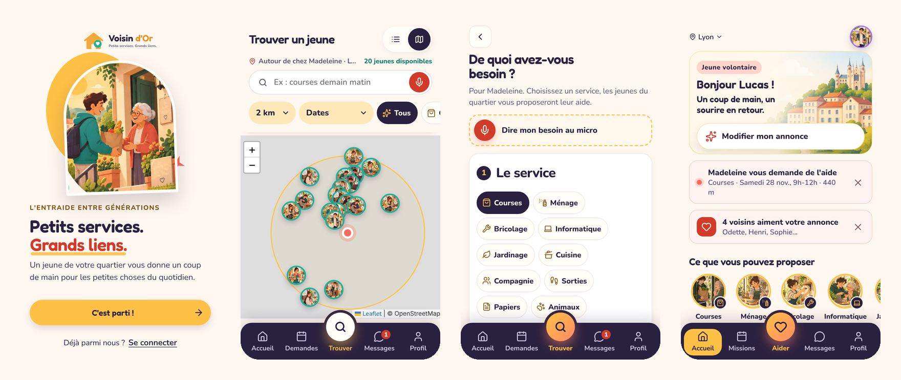

# Voisin d'Or

**Petits services. Grands liens.**

Voisin d'Or met en relation des jeunes du quartier avec des personnes âgées et leurs proches pour des petits services du quotidien : courses, ménage, bricolage, informatique, jardinage, cuisine, compagnie, sorties, papiers, animaux.

**Essayer l'application : [voisin-dor-app.vercel.app](https://voisin-dor-app.vercel.app)** (pensée pour le téléphone)



---

## Sommaire

- [Le besoin](#le-besoin)
- [Ce que fait l'application](#ce-que-fait-lapplication)
- [Stack technique](#stack-technique)
- [Intelligence artificielle](#intelligence-artificielle)
- [Gestion de projet](#gestion-de-projet)
- [Organisation du dépôt](#organisation-du-dépôt)
- [Lancer le projet](#lancer-le-projet)
- [Tests](#tests)
- [Données personnelles](#données-personnelles)
- [Équipe](#équipe)

---

## Le besoin

Beaucoup de personnes âgées ont besoin d'un coup de main ponctuel sans vouloir passer par une entreprise de services. De leur côté, beaucoup de jeunes sont prêts à aider près de chez eux. Il manque un moyen simple, rassurant et local de se trouver.

## Ce que fait l'application

Avant de commencer, on choisit son rôle : **personne âgée**, **proche accompagnateur** ou **jeune volontaire**.

| Personne âgée ou proche | Jeune volontaire |
|---|---|
| Trouver un jeune près de chez soi, sur une carte ou en liste | Publier son annonce : ce qu'il sait faire et ses créneaux |
| Chercher en parlant : « des courses samedi matin » | Voir les besoins du quartier sur une carte ou en liste |
| Publier un besoin, avec une ou plusieurs dates | Proposer son aide sur un besoin |
| Envoyer une demande à un jeune précis | Accepter ou refuser une demande |
| Suivre ses demandes et laisser un avis | Suivre ses missions |
| Échanger par messagerie | Échanger par messagerie |

Un proche peut gérer les demandes à la place de la personne âgée qu'il accompagne.

## Stack technique

| Outil | Rôle dans l'application |
|---|---|
| **React** | Interface de l'application (écrans, formulaires, navigation) |
| **Supabase** | Base de données (utilisateurs, demandes, besoins, messages), connexion par e-mail et stockage des photos, hébergé à Paris |
| **Vercel** | Mise en ligne automatique à chaque `git push` sur `main` |
| **Leaflet + OpenStreetMap** | Carte du quartier avec les jeunes ou les besoins autour de soi |
| **API Adresse (data.gouv.fr)** | Transforme l'adresse en position pour calculer les distances, partout en France |
| **Open-Meteo** | Météo du jour du service, utile pour une sortie ou du jardinage |
| **Overpass (OpenStreetMap)** | Commerces et pharmacies proches pour une demande de courses |
| **Web Speech API** | Dictée vocale : on parle au lieu d'écrire |
| **Playwright** | Tests automatiques sur un écran de téléphone |

Toutes les API utilisées sont gratuites et ne demandent pas de clé.

## Intelligence artificielle

- **Dans l'application** : la dictée vocale utilise la reconnaissance vocale du téléphone, un modèle d'IA (Google sur Android, Apple sur iPhone). La personne dit « J'ai besoin de quelqu'un pour mes courses samedi à 10h » et le texte apparaît.
- **Compréhension de la demande** : le texte dicté est ensuite analysé par notre propre code pour trouver le service, la précision, le jour et l'heure. Les champs du formulaire se remplissent alors tout seuls. Nous avons choisi des règles écrites par nous plutôt qu'un service d'IA externe : ça marche sans abonnement, et les messages des personnes âgées ne sont pas envoyés à une entreprise.
- **Pendant le projet** : nous avons utilisé l'IA comme assistant pour le code, la génération des illustrations et la préparation de la vidéo. Chaque proposition a été relue, testée et corrigée par l'équipe.

## Gestion de projet

- **User stories** : [`specs/user-stories.md`](specs/user-stories.md), suivies dans les **issues GitHub**
- **Maquettes** : réalisées directement en HTML dans [`design/`](design/), pour les tester tout de suite sur un vrai téléphone
- **Conception** : diagramme UML ([`specs/uml.png`](specs/uml.png)) et description de l'API ([`specs/openapi.yaml`](specs/openapi.yaml))
- **Site vitrine** : [`landing/`](landing/)

## Organisation du dépôt

| Dossier | Contenu |
|---|---|
| `src/` | Code de l'application React |
| `public/` | Images, illustrations, logos |
| `supabase/` | Schéma de la base (tables, règles de sécurité, photos) |
| `specs/` | User stories, UML, OpenAPI, données fictives |
| `design/` | Dossier de conception en HTML : maquettes, charte, Lean Canvas, roadmap |
| `landing/` | Site vitrine |
| `tests/` | Tests Playwright |
| `docs/` | Guide technique et captures |
| `workers/` | Worker Cloudflare (adresse vers position) |

## Lancer le projet

```bash
npm install
npm start
```

L'application s'ouvre sur `http://localhost:3000`.

**Mode test** (sans base de données, avec les utilisateurs fictifs de `specs/donnees.json`) :

```bash
# macOS / Linux
REACT_APP_MODE=test npm start

# Windows (PowerShell)
$env:REACT_APP_MODE="test"; npm start
```

**Avec Supabase**, définir ces variables dans Vercel ou dans un fichier `.env.local` :

```
REACT_APP_BACKEND=supabase
REACT_APP_SUPABASE_URL=https://<projet>.supabase.co
REACT_APP_SUPABASE_KEY=<clé publishable>
```

Importer les données fictives dans Supabase :

```bash
SUPABASE_URL=... SUPABASE_SERVICE_ROLE_KEY=... npm run donnees:supabase
```

## Tests

81 tests automatiques couvrent les parcours principaux : inscription, choix du rôle, recherche, carte, demande, besoin, annonce, messagerie, dictée vocale et accessibilité. Ils tournent sur un écran de téléphone.

```bash
npx playwright install chromium
npx playwright test -c tests/playwright.config.js
```

Le rapport HTML se trouve dans `tests/resultats/rapport/`.

## Données personnelles

- L'adresse n'est jamais affichée : seule une distance approximative est visible.
- Le numéro de téléphone ne s'affiche que pendant un service accepté.
- Les données sont hébergées dans l'Union européenne (Supabase, région Paris).

## Équipe

| Rôle | Membre |
|---|---|
| Product Owner | Manel SAADANE |
| Designer | Sofiane TADIMI |
| Développement | Youmna AHAMEDALI et Sara OUABOU |
